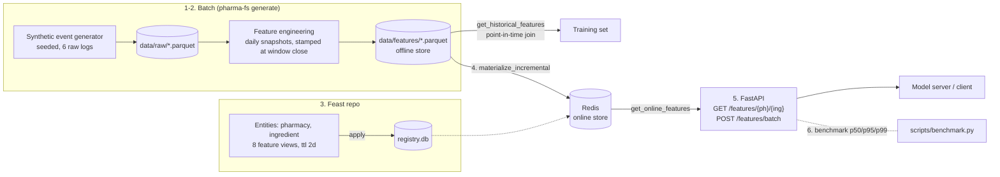

# pharma-feature-store

A **Feast** feature store for compounding pharmacies. It serves real-time operational
indicators (ingredient consumption, stock coverage, supplier lead time, lot
expiration, quote conversion, production queue) to ML models from a **Redis** online
store. Training sets come from **point-in-time correct** historical retrieval.

> **Demo with synthetic data.** Every pharmacy, ingredient, quote and order here comes
> from a seeded generator. This is a portfolio project that demonstrates feature-store
> engineering. It is not a production system, it is not a medical system, and it makes
> no clinical or dispensing decisions.

## The problem

A compounding pharmacy (a pharmacy that prepares personalised medicines from raw
ingredients) runs on a few operational questions:

* Will this ingredient run out before the supplier can deliver?
* Which lots expire soon?
* How long is the production queue right now?
* Is this tenant converting fewer quotes than usual?

Models that answer these questions (stock-out risk, reorder suggestions,
production-time estimates) need two things:

1. **Training data without leakage.** Each historical example must see only what was
   known at that time. A 30-day consumption figure that includes tomorrow makes a model
   look great offline and fail in production.
2. **The same features at inference time, fast.** A model server needs the current
   values for one ingredient, or for 50 at once, in milliseconds. Recomputing them from
   raw events on every request is too slow.

A feature store solves both with **one definition per feature**: an offline store for
point-in-time joins, and an online store (Redis) materialized from it. The setup is
multi-tenant: every feature is keyed by `pharmacy_id`, and stock features are also keyed
by `ingredient_id`.

## Architecture



## Guided tour

The repo is meant to be read in order. Each part explains the problem, the code, how to
run that part alone, and what to look for in its output.

1. [Synthetic data generation](docs/01-data-generation.md): raw event logs from a small, consistent simulation
2. [Feature engineering](docs/02-feature-engineering.md): daily snapshots built only from the past
3. [The Feast repository](docs/03-feast-repo.md): entities, sources, 8 feature views, ttl
4. [Point-in-time retrieval and incremental materialization](docs/04-point-in-time-and-materialization.md): the leakage tests and incremental Redis loads
5. [Online serving and benchmarks](docs/05-benchmarks.md): the FastAPI service and measured latency
6. [Docker, compose and CI](docs/06-deployment.md)

Raw benchmark output, hardware and commands: [docs/benchmarks.md](docs/benchmarks.md).

## How to run

### With docker compose

> The compose file and Dockerfile are included, but the full stack could not be built on
> the author's machine: the Docker Desktop VM could not pull the base image. Only the
> `redis` service was run. See [docs/benchmarks.md](docs/benchmarks.md).

```bash
docker compose up --build
# redis -> materialize (generate + apply + materialize, then exits) -> api on :8000
curl http://localhost:8000/features/ph_001/ing_0001
```

### Locally (Python 3.11+)

```bash
python -m venv .venv && source .venv/bin/activate    # Windows: .venv\Scripts\activate
pip install -e ".[dev]"
docker compose up -d redis                           # only Redis in Docker

pharma-fs generate                     # raw events + feature tables (seed 42)
pharma-fs apply                        # register Feast definitions
pharma-fs materialize --end 2026-04-01 # first (bootstrap) load
pharma-fs materialize                  # incremental: 2026-04-01 -> 2026-06-30
uvicorn pharma_fs.api:app --port 8000

pytest -q                              # 19 tests; the Redis one skips if no Redis
```

Copy `.env.example` to `.env` (or export the variables) to point at a different Redis.

## API examples

```bash
# one pharmacy x ingredient
curl http://localhost:8000/features/ph_001/ing_0001
```

```json
{"pharmacy_id":"ph_001","ingredient_id":"ing_0001","features":{
  "consumption_7d_g":135.191,"consumption_30d_g":536.624,
  "stock_g":731.8,"avg_daily_consumption_30d_g":17.887,"stock_coverage_days":40.911,
  "lead_time_avg_last5_days":11.532,"lead_time_last_days":10.065,"received_orders_count":4,
  "days_to_nearest_expiration":46.023,"lots_expiring_30d":0,"active_lots":1,
  "quotes_created_30d":805,"quotes_converted_30d":457,"quote_conversion_rate_30d":0.5677,
  "production_queue_size":6,"avg_production_time_30d_min":53.051,"finished_orders_30d":477}}
```

```bash
# batch (up to 1000 entities, one Redis round trip through Feast)
curl -X POST http://localhost:8000/features/batch -H "content-type: application/json" \
  -d '{"entities":[{"pharmacy_id":"ph_002","ingredient_id":"ing_0003"},
                   {"pharmacy_id":"ph_999","ingredient_id":"x"}]}'
# -> results in request order; unknown entities come back with all features null

curl http://localhost:8000/features/ph_999/x      # 404: nothing known for this entity
curl http://localhost:8000/features               # list of served feature references
curl http://localhost:8000/health                 # {"status":"ok","online_store":"redis"}
```

## Benchmark

Measured on an i7-1185G7 laptop (4 cores / 8 threads, 39.7 GB RAM, Windows 11), with
one uvicorn worker on the host and Redis 7.4 in Docker Desktop (2-vCPU / 1 GB VM). Each
scenario sends 1000 requests after 50 warm-up requests, and every request returns all
17 features. Command, raw output and a second run are in
[docs/benchmarks.md](docs/benchmarks.md).

| scenario | concurrency | p50 ms | p95 ms | p99 ms | req/s |
|---|---:|---:|---:|---:|---:|
| Feast SDK direct, 1 entity | 1 | 1.90 | 3.59 | 7.27 | 455.9 |
| Feast SDK direct, 50 entities | 1 | 16.39 | 34.58 | 59.54 | 48.8 |
| HTTP `GET /features/{ph}/{ing}` | 1 | 4.09 | 5.49 | 7.90 | 225.8 |
| HTTP `GET /features/{ph}/{ing}` | 10 | 20.03 | 118.59 | 261.59 | 284.7 |
| HTTP `GET /features/{ph}/{ing}` | 50 | 234.18 | 903.48 | 1237.78 | 156.9 |
| HTTP `POST /features/batch` (50) | 1 | 14.22 | 16.83 | 20.07 | 65.9 |
| HTTP `POST /features/batch` (50) | 10 | 125.83 | 179.99 | 212.78 | 78.5 |
| HTTP `POST /features/batch` (50) | 50 | 698.76 | 920.24 | 1684.03 | 68.9 |

Takeaways: a single-entity online read takes ~4 ms over HTTP (~2 ms through the SDK
alone). A 50-entity batch takes ~14 ms, about 0.3 ms per entity. One Python process
saturates at roughly 230–285 single requests/s, and above that extra concurrency only
adds queueing. Tail latencies varied between runs on this machine (one run had
multi-second p99 outliers), so p99 is indicative only. Multi-worker scaling was **not**
measured: uvicorn's multi-process mode failed on Windows.

## Design decisions and trade-offs

* **Pre-aggregated daily snapshots, stamped at window close.** Feast's file offline
  store joins rows; it does not compute windows. Each feature row is stamped at the
  instant its window closes, so a row at `D` uses only events `< D`. A test corrupts all
  future raw events and checks that past features do not change, because Feast cannot
  catch leakage introduced upstream.
* **Two independent proofs of point-in-time correctness.** A sentinel value placed one
  second in the future must never appear. Every historical value must also equal an
  independent `merge_asof(direction="backward", tolerance=ttl)` oracle over about 300
  random timestamps.
* **ttl = 2 days on daily tables.** This is long enough to bridge one missed snapshot
  and short enough that stale data shows up as null instead of being served silently.
* **Definitions in the package, not only in `feature_repo/`.** The API, the
  materialization job, the tests and the `feast` CLI all use the same Python objects.
* **Tests run without Redis.** `build_store()` builds a store with SQLite in a temp
  directory. One integration test uses real Redis (DB 15) and runs in CI against a
  Redis service container.
* **Sync handlers + one Feast call per request.** The Feast SDK read is blocking, so the
  handlers are `def` and FastAPI runs them in its thread pool. The batch endpoint
  fetches all entities in one `get_online_features` call.
* **File offline store.** This is simple and reproducible, and fine for about 140k
  feature rows. A real deployment would use a warehouse (BigQuery, Snowflake, Spark)
  and a scheduler for materialization.

## Limitations

* Synthetic data from a simplified simulation. Feature distributions are plausible but
  not calibrated to any real pharmacy.
* The materialization bootstrap uses an explicit start date, because Feast's first
  incremental run starts at wall-clock `now - ttl` and the data sits in a fixed 2026
  window (see [part 4](docs/04-point-in-time-and-materialization.md)).
* Latency numbers come from one laptop, with Redis inside Docker Desktop's 2-vCPU VM.
  They show relative behaviour, not production capacity. Multi-worker scaling and the
  containerised API were not measured (see [docs/benchmarks.md](docs/benchmarks.md)).
* `docker compose up` (image build, materialize job, containerised API) was written but
  not run end to end on the development machine. Only its Redis service was used.
* Feast's async online read (`get_online_features_async`) was tried and hung against
  Redis in Docker Desktop on this Windows machine. The service uses the sync path, and
  the async path was not benchmarked.
* No authentication, rate limiting or tenant isolation on the API. Any caller can read
  any pharmacy's features.
* The file offline store de-duplicates entity rows with identical keys and timestamps
  (observed with feast 0.68).

## Future work

* Streaming updates (push source) for intra-day features such as the production queue.
* On-demand feature views for request-time features (e.g. the quantity requested in a quote).
* Feast feature server / Go server or async Redis reads, compared with this service.
* Warehouse offline store and an orchestrated (Airflow/Dagster) daily materialization.
* Per-tenant auth on the API, and a feature-freshness monitor that alerts when snapshots stop arriving.

## License

MIT, see [LICENSE](LICENSE).
